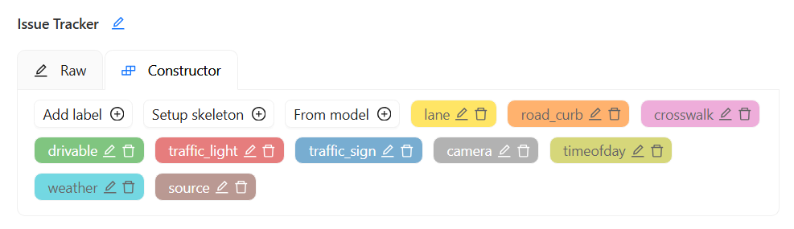
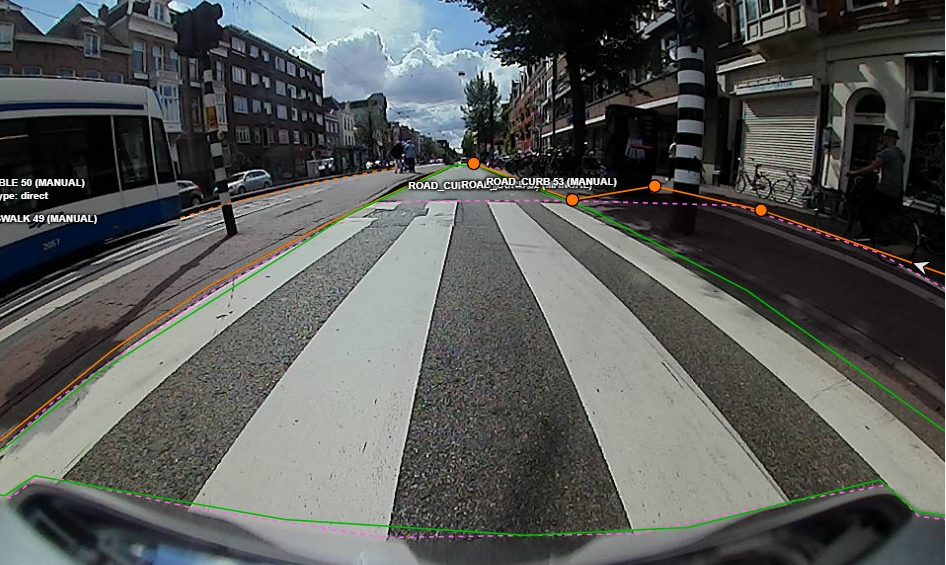
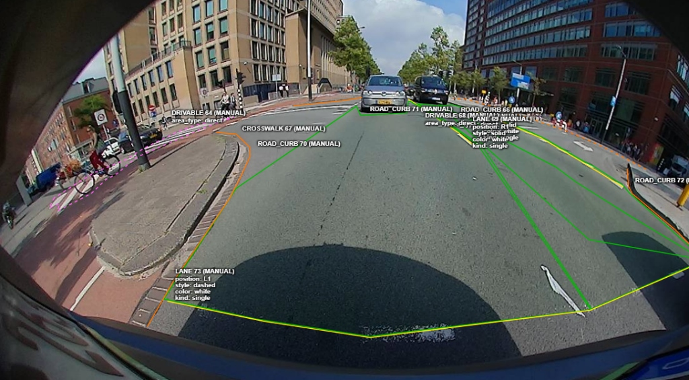
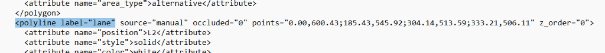

# Báo cáo cá nhân — Ngày 11
Họ tên: Vũ Gia Khang              Mã học viên: 2A202604069  
Phiên bản CVAT (Help → About): CVAT v2.82.0  
Guideline: Road v1.0    Lần nộp (`revision` trong manifest): 1  
Thời điểm export: 2026-11-21    Số lần nộp lại sau Rework: 0  

## 1. Kiểm project
| Mục | Đúng như guideline Road v1.0? | Ghi chú |
| --- | --- | --- |
| 6 label, đúng kiểu | Có | lane (polyline), road_curb (polyline), crosswalk (polygon), drivable (polygon), traffic_light (box), traffic_sign (box) |
| Thuộc tính và giá trị | Có | Khớp 100% với taxonomy.py và Road v1.0 |
| 4 tag ảnh | Có | camera (select), timeofday (select), weather (select), source (select) |

Cách kết thúc polyline trên bản CVAT này: Nhấn phím `N` hoặc click đúp chuột vào điểm cuối.  
Cách đặt tag ảnh trên bản CVAT này: Chọn công cụ Tag ở thanh bên trái, chọn label rồi vào bảng Objects mở Details để chọn đúng giá trị dropdown `value`.  

## 2. Số lượng đã gán
| Task | Ảnh | lane | road_curb | crosswalk | drivable | traffic_light | traffic_sign |
| --- | ---: | ---: | ---: | ---: | ---: | ---: | ---: |
| front | 12 | 31 | 13 | 4 | 26 | 23 | 8 |
| front-extra (đã làm 0 / 4) | 0 | 0 | 0 | 0 | 0 | 0 | 0 |
| fisheye | 8 | 16 | 22 | 11 | 8 | 2 | 2 |
| fisheye-extra (đã làm 4 / 4) | 4 | 0 | 7 | 8 | 2 | 0 | 0 |

## 3. Bảng ca khó
| Ảnh | Nhãn | Phân vân giữa | Đã chọn | Lý do |
| --- | --- | --- | --- | --- |
| A05 | lane / road_curb | Thiếu vạch R1 | Không vẽ R1, chỉ vẽ road_curb | Mép phải đường là gờ bó vỉa hè không có vạch sơn kẻ, tuân thủ đúng Guideline Road v1.0 (không bịa thêm vạch) |
| A06 | lane / road_curb | Thiếu vạch R1 | road_curb | Bên phải xe là lề đường lát đá/vỉa hè không có sơn vạch phân làn |
| B06 | lane | position = L1 hay other | position = other | Quy tắc Guideline Road v1.0: Mọi camera hai bên (fisheye_left, fisheye_right) bắt buộc phải mang position = other (tránh bẫy QC1-03) |
| B11 | lane / ô đỗ | Vẽ lane vào ô đỗ xe khuyết tật / chevron hay bỏ qua | Bỏ qua vạch ô đỗ, chỉ gán road_curb | Bẫy QC1-03: Guideline Road v1.0 Mục 4 quy định vạch ô đỗ không gán lane |

## 4. Phiếu QC 1 nhận được
Bạn kiểm lô của tôi: Khưu Minh Phú  Quyết định nhận được: Release  
| Mã lỗi | Số lỗi | Đồng ý? | Đã sửa? |
| --- | ---: | --- | --- |
| QC1-01 | 0 | Đồng ý | Đã chuẩn hóa tag camera B10 thành fisheye_left |
| QC1-02 | 0 | Đồng ý | A05, A06 thực tế không có vạch R1 (mép vỉa hè) |
| QC1-03 | 0 | Đồng ý | Đã chỉnh toàn bộ lane camera hông (B06, B07, B08) thành position=other |

## 5. Kiểm file export
| File | Mở lại được? | Số shape ảnh 1 (job / file) | Số shape ảnh 2 (job / file) | Tag camera có trong XML? |
| --- | --- | --- | --- | --- |
| vugiakhang-front.zip | Có | 10 / 10 | 8 / 8 | Có (camera=front) |
| vugiakhang-fisheye.zip | Có | 5 / 5 | 9 / 9 | Có (camera=fisheye_front / rear / left / right) |

## 6. Ảnh chụp màn hình
1. **Tab Labels của project:**  
   

2. **Một ảnh camera trước đã gán đủ (làn, vùng lái, đèn/biển - A06):**  
   

3. **Một ảnh fisheye đã gán, phóng to đoạn polyline cong (B03):**  
   

4. **Một đoạn XML có `<polyline label="lane">`:**  
   

## 7. Tự đánh giá
* **Lỗi bạn mắc nhiều nhất hôm nay (theo mã QC1-xx), và cách tránh ở Ngày 20:**  
  Lỗi nhầm lẫn thuộc tính mặc định của CVAT (CVAT luôn tự điền `L1` cho lane và `fisheye_front` cho camera). Cách tránh: Sau khi vẽ bất kỳ đối tượng nào hoặc gắn tag, luôn mở mục Details kiểm tra lại `position` (chọn `other` cho camera hông) và tag `camera`.
* **Nhãn của bạn đi vào model ở đâu? Chọn một lỗi đã sửa và nói nó làm model học sai thế nào:**  
  Nếu gán nhầm vạch ô đỗ xe / vạch chevron thành `lane` (như ở ảnh B11) hoặc gán vạch camera hông thành `L1` thay vì `other`, mô hình điều khiển giữ làn (LKA - Lane Keeping Assist) sẽ coi các vạch chéo trong bãi đỗ là tâm làn đường xe chạy, dẫn đến việc xe tự hành bẻ lái đột ngột đâm vào các xe đang đỗ hoặc lao lên lề đường.
